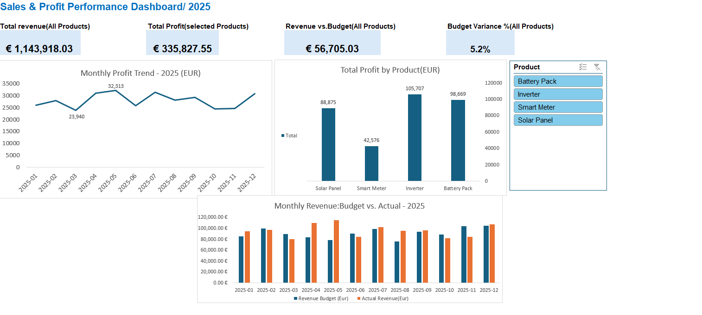

# Sales & Profit Performance Dashboard | Excel
## Project Overview
## An interactive Excel dashboard developed to analyze sales revenue, profitability, and budget performance using practice data.
## Key Features

- Revenue and profit KPI summaries
- Monthly profit trend analysis
- Profit comparison across product categories
- Monthly actual revenue vs. budget comparison
- Interactive product filtering using Excel slicers

## Tools & Skills
- Microsoft Excel
- PivotTables and PivotCharts
- Slicers
- Excel formulas
- Data visualization
- Sales and budget analysis
## Dashboard Preview

## How to Use
Download the Excel workbook, open it in Microsoft Excel, and use the Product slicer to explore profit performance by product.
## Note
This is a portfolio practice project based on sample data, created to demonstrate Excel reporting and dashboard development skills.
